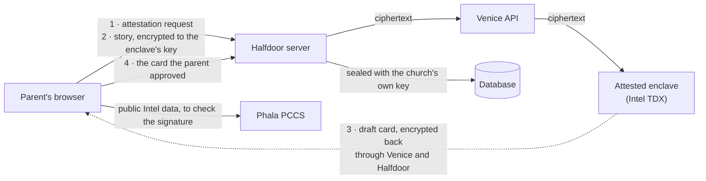

# Halfdoor

**Every child, known at the door.** Parents write about their child in their own words; the volunteer buddy sees a card made from those words, only while the child is checked in.

## Why

Sunday, a little after nine. A mother sits in the lobby with her phone in her hand, watching the screen above the kids' wing for her son's number. Fifteen minutes in, it comes up. The volunteer in Room B is new this week and didn't know that loud worship is hard for him, or that his headphones are in his backpack.

After a few Sundays like that, families stop coming. **1 in 3 parents of children with disabilities have left a church because their child wasn't included or welcomed** (Ault, Collins & Carter, 2013, n = 416). Most churches don't lack love. The volunteer at the door just didn't know.

Halfdoor hands the volunteer what the parent knows, in the parent's words, before the child walks in, and takes it back the moment the child leaves.

## Try it in 2 minutes

Open **[halfdoor.vercel.app/demo](https://halfdoor.vercel.app/demo)**. No account. You get a private copy of **Fernbrook Community Church** (fictional, sample data) for 24 hours. The **Try a Sunday** guide walks through Sam's first Sunday; each **Go** button switches to the right person and page.

1. **Jordan writes about Sam**, watches the enclave check pass, and approves the card.
2. **Hannah reviews Sam's card**: the kids' director acknowledges it.
3. **Match Sam with a buddy**: suggest buddies for 9:00, read the reasons, approve.
4. **Check Sam in** at the simulated check-in station.
5. **The buddy opens Sam's card**, unlocked only while Sam is checked in, and logs a moment.
6. **Check Sam out**: the card locks and is cleared from the phone.
7. **Approve the note home**: Jordan sees it only after Hannah approves.

Then **Open Jordan's page** for the note and who opened Sam's card. The 5-minute version, with what to look for at each step: [JUDGES.md](JUDGES.md).

## How it works

1. **Tell.** A parent writes about their child in their own words, in any language.
2. **Check.** Every card line points back to the words it came from. Safety lines (allergies, medical, who may pick up) are copied word for word. Anything that can't be pointed to is left out, and the parent sees what was left out. A safety sentence that didn't make the card comes back as "Is this a safety note?". Nothing is visible to anyone until the parent approves.
3. **Match.** The kids' director pairs a trained buddy: training current, background check valid, the same buddy as last time when possible. Every match says why; every gap says what stands in the way.
4. **Open, then close.** The card is locked on the buddy's phone until the child is checked in, and locks again at checkout. The parent sees who opened it and when.

**After the service,** the buddy's one-tap moments become a short note home in the parent's language. Each sentence must rest on a logged moment, and the parent sees it only after the director approves. Halfdoor sends nothing by itself. The director also gets a **Sunday pack**: the lesson as a picture schedule with each child's supports on the right step, and the verse word for word from the Berean Standard Bible.

## Privacy by design



> "Before anything is sent, your browser checks that the enclave's key and your one-time code are sealed in an Intel TDX report and verifies Intel's signature on it. If either check fails, nothing is sent."

The app's own words ([`attestation.ts`](src/lib/crypto/attestation.ts)), shown under the parent's writing box.

| Who | Sees |
|---|---|
| Parent's browser | The story, the draft, the card. The story stays on this device. |
| Halfdoor server | The story only as ciphertext, never stored. The approved card when it is saved, then sealed with the church's key. |
| Venice | Ciphertext, the model name, token counts. |
| The enclave | The story with the child's first name replaced, to draft the card. |
| Phala PCCS | The browser's IP address. No child data. |
| Fontshare (font CDN) | Every visitor's IP address, when a page loads its font. No child data. |

- **Access gate, in code** ([`gate.ts`](src/lib/access/gate.ts)): a buddy opens a card only with a match the director approved for that service, a card the director acknowledged, and the child checked in and not checked out, from 30 minutes before the service to 30 minutes after. While a card is being updated (the parent changed it, or the director sent it back) the buddy keeps only its safety lines. Room leaders see safety lines only. The director's reads are logged too, and the director never sees a draft.
- **Access log:** every opening by the team is shown to the parent: "Priya opened Leo's card · Sun 8:52–10:14 (while Leo was checked in)".
- **AI ledger:** every AI call with its purpose, model, protection and cost. Prompts and answers are never stored.
- **Retention:** cards are deleted 12 months after the child's last check-in, or whenever the parent deletes them.

Details: [PRIVACY.md](PRIVACY.md).

## Measured

<!-- eval:stories -->60<!-- /eval:stories --> synthetic parent stories (<!-- eval:stories-en -->35<!-- /eval:stories-en --> English, <!-- eval:stories-es -->25<!-- /eval:stories-es --> Spanish), each with a hidden answer key: allergies a child outgrew, who is NOT allowed to pick up, a medicine that was stopped. We compared Halfdoor's card with a plain one-page AI summary and a short prompted card, from the same enclave model (<!-- eval:model -->e2ee-deepseek-v4-flash<!-- /eval:model -->) and from <!-- eval:claude-model -->claude-sonnet-5-5<!-- /eval:claude-model -->.

**On safety facts, a plain AI summary did as well as Halfdoor.** After hand review, the one-page Claude summary kept <!-- eval:baseline_claude-reviewed-present -->100.0% (157/157)<!-- /eval:baseline_claude-reviewed-present -->; Halfdoor kept <!-- eval:halfdoor-reviewed-present -->99.4% (156/157)<!-- /eval:halfdoor-reviewed-present -->, and <!-- eval:halfdoor_net-reviewed-present -->100.0% (157/157)<!-- /eval:halfdoor_net-reviewed-present --> once the parent accepts its safety prompts. Wrong safety claims in the plain outputs: <!-- eval:baselines-trap-review -->4 flagged automatically, 0 confirmed by hand review<!-- /eval:baselines-trap-review -->. Halfdoor's case is provenance, privacy and a fixed card shape, not recall.

**What changes is what gets added.** Outputs with a sentence the parent never said: short prompted card <!-- eval:baseline_claude_short-added -->28 of 54<!-- /eval:baseline_claude_short-added --> (Claude) and <!-- eval:baseline_same_short-added -->13 of 51<!-- /eval:baseline_same_short-added --> (same model); Halfdoor <!-- eval:halfdoor-added -->3 of 58<!-- /eval:halfdoor-added -->. That low count is by construction (the verifier drops any line it can't point to), so it shows the verifier works, not a separate finding. A prompt makes faithful cards likely; Halfdoor enforces it.

<!-- eval:summary -->
| System | Model | Safety facts kept | Wrong safety claims | Outputs with a sentence the parent never said | Words, mean |
|---|---|---|---|---|---|
| Halfdoor card | `e2ee-deepseek-v4-flash` | 99.4% (156/157) | 0 | 3 of 58 | 92 |
| Halfdoor card + safety net accepted | `e2ee-deepseek-v4-flash` | 100.0% (157/157) | 0 | 3 of 58 | 93 |
| Plain summary, same enclave model | `e2ee-deepseek-v4-flash` | 100.0% (157/157) | 0 | 33 of 33 | 258 |
| Plain summary, Claude Sonnet 5.5 | `claude-sonnet-5-5` | 100.0% (157/157) | 0 | 52 of 52 | 291 |
| Short card prompt, same enclave model | `e2ee-deepseek-v4-flash` | 100.0% (157/157) | 0 | 13 of 51 | 75 |
| Short card prompt, Claude Sonnet 5.5 | `claude-sonnet-5-5` | 100.0% (157/157) | 0 | 28 of 54 | 86 |
<!-- /eval:summary -->

<sub>**Method.** One sample per story and system. Facts and wrong claims are scored automatically against the answer key, then every automatic miss and flag was read by hand ([`adjudication.json`](eval/results/adjudication.json)). "A sentence the parent never said" is a word-overlap rule; a card's title or a heading is not counted as a sentence (the rule was revised after the run to skip them and every output re-scored from the cache, no new model calls: [rule change](eval/results/summary.md#provenance-what-each-output-adds)). On a fresh hand-checked sample of short-card sentences, <!-- eval:grounding-precision -->86.7% (13 of 15)<!-- /eval:grounding-precision --> of flagged sentences really add something and <!-- eval:grounding-passed -->93.3% (14 of 15)<!-- /eval:grounding-passed --> of passed ones really are grounded; the rule errs both ways, so the counts are approximate. Outputs in another language than their story aren't scored for it. Halfdoor drafting median <!-- eval:halfdoor-p50 -->7.1 s<!-- /eval:halfdoor-p50 --> (model calls only), <!-- eval:halfdoor-cost-per-story -->$0.0002<!-- /eval:halfdoor-cost-per-story --> per card at Venice list prices. Everything: [`eval/results/summary.md`](eval/results/summary.md).</sub>

## Built for Planning Center

Halfdoor is designed to sit on Planning Center, not replace it. The live connection is **not part of this demo**; the Check-Ins, Services and People shapes and the hook points are in the code:

- **Check-Ins** would open and close the card. Check-Ins has no webhooks, so the design polls, only while a buddy phone or room view is open, about every 8 seconds per church.
- **Services:** an approved match would be scheduled onto the plan's buddy team, without notifications, and the matcher would skip buddies scheduled elsewhere.
- **People:** on approval, a note on the child's record would say a card is on file, never what it says.

The data model carries Planning Center ids, and the hook points sit where they belong: card approval, match approval, the check-in poll and the matcher's availability check ([`src/lib/pco/hooks.ts`](src/lib/pco/hooks.ts)). The API calls behind them are not written, and no Planning Center organisation is connected. In the demo, a clearly labelled **Simulated check-in station** stands in for Check-Ins ([MOCKS.md](MOCKS.md)), and the desk's **Schedule in Planning Center** button stays inactive and says why.

## Architecture

- **App:** Next.js 16 (App Router), React 19, TypeScript, Tailwind CSS 4
- **Data:** Postgres (Supabase) via Drizzle, server-only; card content sealed with AES-256-GCM under a per-church key
- **Enclave path:** Venice end-to-end encrypted models; secp256k1 ECDH, HKDF-SHA256 and AES-256-GCM in the browser (`@noble/*`); TDX quote and Intel signature checks in the browser (`@phala/dcap-qvl`)
- **Models:** child data only to `e2ee-*` models in an attested enclave; the lesson (no child data) to Claude Sonnet 5.5 on Venice; every answer checked by code
- **Content:** ARASAAC pictograms; Scripture via `@faith-tools/bible-sdk` (BSB)
- **Tests:** Vitest on in-memory Postgres (PGlite); one Playwright test of the whole Sunday

```
src/app/            pages (/demo, /c/[slug]/parent|desk|buddy|room|station) and API routes
src/components/     parent, desk, buddy, room, station, landing, shared UI
src/lib/card/       story to card: prompts, pipeline, verifier, safety net
src/lib/crypto/     enclave encryption, TDX quote checks, at-rest sealing
src/lib/access/     access gate, access log, retention
src/lib/solver/     buddy matching (Hungarian assignment over hard rules)
src/lib/schedule/   lesson to picture schedule, social story, verse
src/lib/note/       moments to the note home, with its verifier
src/lib/pco/        Planning Center hook points (no live connection yet)
src/db/             schema, repositories, demo-church seed
eval/               stories with answer keys, scorer, results
tests/              unit and end-to-end tests
```

## Run locally

Node 22+ and pnpm 9. The app needs Postgres with a schema named `halfdoor` owned by the connecting role (a free Supabase project works); unit tests don't.

| Variable | What it is |
|---|---|
| `VENICE_API_KEY` | Venice API key |
| `DATABASE_URL` | Postgres connection string |
| `MASTER_KEY` | 32 random bytes, base64; wraps each church's data key |
| `LINK_SECRET` | 16+ random bytes, base64url; signs links and cookies |
| `APP_URL` | public URL of the app |
| `NEXT_PUBLIC_REPO_URL` | optional; source link on the landing page |

No Planning Center variables: the live Planning Center connection is not built yet.

```bash
cp .env.example .env.local   # then fill it in
pnpm i
pnpm db:migrate
pnpm dev                     # http://localhost:3000, then /demo
pnpm test                    # unit tests
pnpm test:e2e                # the whole Sunday in a browser, with recorded model outputs
pnpm eval                    # the evaluation (paid model calls)
```

`pnpm eval` caches every model call in `eval/.cache/`, so re-runs are free, and `--max-usd` (default $5) stops it before it spends more. The run behind the numbers above cost <!-- eval:eval-cost -->$0.60<!-- /eval:eval-cost --> at Venice list prices. Try `--limit 2` first.

## Honest limits

- **The enclave check trusts Intel and the TEE operators behind Venice (Phala, NEAR AI).** In the app's words: "We don't yet check the enclave's software measurement against a published list." We check that the key is sealed in a genuine, non-debug Intel TDX report, not which software image runs there.
- **The server sees the approved card when it is saved,** before sealing it. The raw story never reaches it in plain text.
- **No live Planning Center connection.** Halfdoor is built for it (shapes and hook points in the code), but the demo runs on a labelled simulated check-in station. Check-Ins has no webhooks, so a live connection would poll, not push.
- **Demo clock:** demo churches are created when you open them, so their pages shift displayed times to make the first service read 9:00 on a Sunday.
- **The added-sentence measure is approximate** (<!-- eval:grounding-precision -->86.7% (13 of 15)<!-- /eval:grounding-precision --> precision on a hand-checked sample of short-card sentences, and it misses some added sentences too), and the stories are synthetic.
- **Expired cards are deleted when the demo is opened,** not by a scheduled job yet.
- **Paraphrase and translation checks cover English and Spanish;** in other languages every line is the parent's own sentence.
- **ARASAAC pictograms are non-commercial** (CC BY-NC-SA).

Every public statement, tagged reproducible, verified live, modeled or not claimed: [CLAIMS.md](CLAIMS.md).

## Licence and attributions

Code: [MIT](LICENSE).

- Pictograms: Sergio Palao. Origin: ARASAAC (https://arasaac.org). License: CC BY-NC-SA. Owner: Government of Aragón (Spain).
- Scripture: Berean Standard Bible (BSB), public domain, via `@faith-tools/bible-sdk`.
- Type: General Sans by Indian Type Foundry, via Fontshare.
